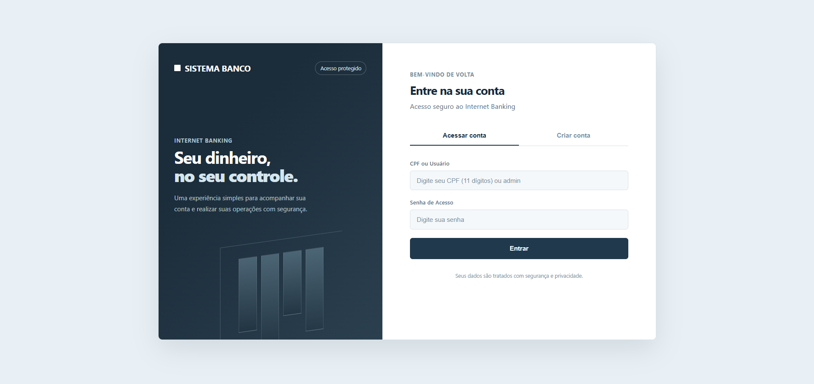
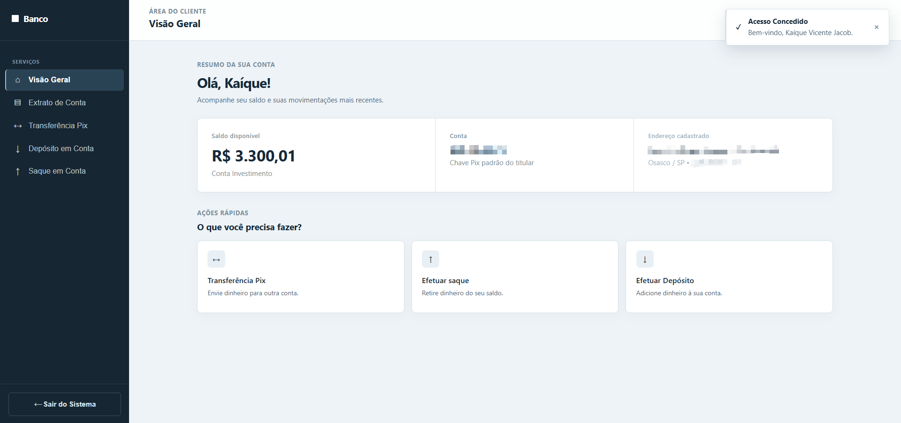

<div align="center">


<h1>SISTEMA DE BANCO</h1>

<p>
  <strong>KAIQUE JACOB</strong> · Java 25 · Spring Boot 4 · Spring Security · MySQL · Docker
</p>

</div>

---

<div align="center">


</div>

## `SOBRE`

API REST de sistema bancário desenvolvida em **Java 25** com **Spring Boot 4**, **Spring Security**, **Spring Data JPA** e **MySQL**.

O sistema oferece:

- 🏦 **Cadastro de contas** corrente, poupança e investimento.
- 💰 **Depósitos e saques** com regras de negócio, taxas e histórico de transações.
- 🔁 **Transferências** entre contas com débito e crédito em uma única transação.
- 🧾 **Extrato** e consulta da própria conta por meio de rotas `/me`.
- 🔐 **Autenticação HTTP Basic** com usuários `CLIENTE` e `ADMIN`.
- 🛡️ **Controle de acesso por papel**, impedindo que um cliente opere a conta de outro usuário.
- 🖥️ **Interface web integrada** para login, cadastro, operações bancárias e área administrativa.
- 📈 **Observabilidade** com Actuator, Prometheus e Grafana.
- 📘 **Documentação interativa** com OpenAPI e Swagger UI.

Os dados são persistidos em **MySQL**, estruturados sob princípios de **Domain-Driven Design (DDD)**, **Clean Architecture** e **Ports & Adapters**.

---

## `FLUXO DA APLICAÇÃO`

```text
                 ┌──────────────────────────────────────────┐
                 │           CLIENTE / ADMINISTRADOR         │
                 │        Interface Web + HTTP Basic         │
                 └────────────────────┬─────────────────────┘
                                      │
                                      ▼
                 ┌──────────────────────────────────────────┐
                 │              PRESENTATION                │
                 │  Controllers · DTOs · Validation · Errors │
                 └────────────────────┬─────────────────────┘
                                      │
                                      ▼
                 ┌──────────────────────────────────────────┐
                 │              APPLICATION                 │
                 │      ContaService · RegistroDeConta      │
                 └────────────────────┬─────────────────────┘
                                      │
                                      ▼
                 ┌──────────────────────────────────────────┐
                 │                 DOMAIN                   │
                 │  ContaBancaria · Transacao · Regras      │
                 └────────────────────┬─────────────────────┘
                                      │
                                      ▼
                 ┌──────────────────────────────────────────┐
                 │             INFRASTRUCTURE               │
                 │  JPA/MySQL · ViaCEP · Security · Docs    │
                 └──────────────────────────────────────────┘
```

---

## `CONCEITOS APLICADOS`

```text
SISTEMA DE BANCO (SPRING BOOT 4 + JAVA 25)

[✓] Arquitetura em camadas com Domain-Driven Design (DDD)
[✓] Separação entre application, domain, infrastructure e presentation
[✓] Domínio rico com ContaBancaria, ContaCorrente, Poupança e Investimento
[✓] Padrão Factory para criação de contas
[✓] Ports & Adapters com ContaDAO e CredencialDAO
[✓] Persistência com Spring Data JPA, Hibernate e MySQL
[✓] Controle de concorrência com lock otimista (@Version)
[✓] Transações com Spring @Transactional
[✓] Autenticação e autorização com Spring Security
[✓] HTTP Basic stateless com papéis CLIENTE e ADMIN
[✓] Senhas armazenadas com BCrypt
[✓] Validação de entrada com Bean Validation
[✓] Tratamento de erros com ProblemDetail (RFC 9457)
[✓] Integração externa com ViaCEP
[✓] Interface web com HTML, CSS e JavaScript
[✓] Documentação OpenAPI e Swagger UI
[✓] Observabilidade com Actuator, Micrometer, Prometheus e Grafana
[✓] Testes unitários, de integração e de concorrência com JUnit 5
```

---

## `ENDPOINTS DA API`

| Operação | Método / Endpoint | Acesso | Descrição |
|---|---|---|---|
| 🏦 **Criar conta** | `POST /contas` | Público | Cadastra conta, endereço e credencial de acesso |
| 👤 **Minha conta** | `GET /contas/me` | `CLIENTE` | Retorna os dados da conta autenticada |
| 📝 **Meu extrato** | `GET /contas/me/extrato` | `CLIENTE` | Retorna o histórico de transações |
| 💰 **Depositar** | `POST /contas/me/depositos` | `CLIENTE` | Realiza depósito na conta autenticada |
| 🏧 **Sacar** | `POST /contas/me/saques` | `CLIENTE` | Realiza saque na conta autenticada |
| 🔁 **Transferir** | `POST /transferencias` | `CLIENTE` | Transfere da conta autenticada para outra conta |
| 📊 **Listar contas** | `GET /contas` | `ADMIN` | Lista contas paginadas e ordenadas por saldo |
| 🔍 **Buscar conta** | `GET /contas/admin/{cpf}` | `ADMIN` | Consulta uma conta pelo CPF |
| 🧾 **Extrato por CPF** | `GET /contas/admin/{cpf}/extrato` | `ADMIN` | Consulta o extrato de qualquer conta |
| ❌ **Remover conta** | `DELETE /contas/admin/{cpf}` | `ADMIN` | Remove uma conta sem histórico |
| 💸 **Cobrar taxa** | `POST /contas/admin/{cpf}/taxa-manutencao` | `ADMIN` | Cobra a taxa de manutenção da conta |
| ❤️ **Health check** | `GET /actuator/health` | Público | Verifica o estado da aplicação |
| 📈 **Métricas** | `GET /actuator/prometheus` | `ADMIN` | Expõe métricas para o Prometheus |

---

## `INTERFACE WEB`

A aplicação inclui uma interface web servida pelo próprio Spring Boot em `src/main/resources/static`.

### Autenticação

O usuário pode entrar com CPF e senha ou criar uma nova conta.

<div align="center">



<p><sub>Tela de login e acesso à conta.</sub></p>

</div>

<div align="center">



<p><sub>Tela inicial com saldo, operações e dados da conta.</sub></p>

</div>

---

## `SEGURANÇA`

A API utiliza **HTTP Basic** com sessão stateless.

```text
[✓] Cadastro público apenas para criação de conta
[✓] CLIENTE acessa somente a própria conta por /contas/me
[✓] ADMIN acessa listagem, consulta, exclusão e taxa de manutenção
[✓] Rotas não mapeadas são negadas por padrão
[✓] Senhas armazenadas com BCrypt
[✓] Mensagem idêntica para usuário inexistente e senha incorreta
[✓] Seed de administrador controlado por variável de ambiente
[✓] Respostas 401 em JSON, sem popup nativo de autenticação
[✓] CSRF desativado por ser uma API stateless sem cookies
```

> **Limitação:** HTTP Basic envia credenciais em todas as requisições. Em produção, a aplicação deve ser exposta exclusivamente por HTTPS.

---

## `COMO EXECUTAR`

### 1. Pré-requisitos

- **Java 25**
- **Maven 3.9+**
- **Docker** e **Docker Compose**

### 2. Subir a infraestrutura

```bash
docker compose up -d db prometheus grafana
```

O MySQL será iniciado na porta `3307`, o Prometheus em `9090` e o Grafana em `3000`.

### 3. Configurar a senha do administrador

```bash
# Linux/macOS
export ADMIN_PASSWORD=SuaSenhaForte#1

# Windows PowerShell
$env:ADMIN_PASSWORD="SuaSenhaForte#1"
```

O administrador será criado automaticamente no primeiro start, caso ainda não exista.

### 4. Executar a aplicação

```bash
mvn spring-boot:run
```

A interface e a API estarão disponíveis em:

```text
http://localhost:8080
```

### 5. Executar com Swagger

```bash
mvn spring-boot:run -Dspring-boot.run.profiles=dev
```

Acesse:

```text
http://localhost:8080/swagger-ui.html
```

<details>
<summary><strong>💡 Exemplos práticos de requisição (cURL)</strong></summary>

<br>

#### 1. Criar conta

```bash
curl -X POST http://localhost:8080/contas \
  -H "Content-Type: application/json" \
  -d '{
    "titular": "Kaíque Jacob",
    "cpf": "52998224725",
    "email": "kaique@example.com",
    "cep": "01001000",
    "tipo": "CORRENTE",
    "saldoInicial": 1000.00,
    "senha": "SenhaForte#1"
  }'
```

#### 2. Consultar a própria conta

```bash
curl -u 52998224725:SenhaForte#1 \
  http://localhost:8080/contas/me
```

#### 3. Realizar depósito

```bash
curl -X POST http://localhost:8080/contas/me/depositos \
  -u 52998224725:SenhaForte#1 \
  -H "Content-Type: application/json" \
  -d '{"valor": 250.00}'
```

#### 4. Realizar transferência

```bash
curl -X POST http://localhost:8080/transferencias \
  -u 52998224725:SenhaForte#1 \
  -H "Content-Type: application/json" \
  -d '{
    "cpfDestino": "11144477735",
    "valor": 100.00
  }'
```

#### 5. Listar contas como administrador

```bash
curl -u admin:SuaSenhaForte#1 \
  http://localhost:8080/contas
```

</details>

---

## `TESTES AUTOMATIZADOS`

O projeto inclui testes unitários, testes de repositório, testes de segurança, testes de concorrência e testes de integração ponta a ponta.

```bash
mvn test
```

Cenários cobertos:

```text
[✓] Regras de depósito, saque, transferência e taxas
[✓] Criação de contas por tipo
[✓] Persistência e consulta com JPA
[✓] Rollback em falhas de transação
[✓] Conflito de concorrência com lock otimista
[✓] Autenticação HTTP Basic
[✓] Autorização por CLIENTE e ADMIN
[✓] Proteção contra acesso à conta de outro usuário
[✓] Cadastro público e criação de credencial
[✓] Tratamento global de erros
[✓] Integração com ViaCEP
```

---

## `ESTRUTURA DO PROJETO`

A estrutura segue os princípios de **Domain-Driven Design**, **Clean Architecture** e **Ports & Adapters**:

```text
src/main/java/br/com/sistemabanco/
├── application/              # Casos de uso e orquestração do negócio
│   ├── ContaService.java
│   └── RegistroDeConta.java
│
├── domain/                   # Núcleo do negócio, sem dependência de framework
│   ├── exception/            # Exceções de negócio
│   ├── factory/              # Criação de contas
│   ├── model/                # ContaBancaria, Transacao, Endereco e tipos
│   ├── repository/           # Portas: ContaDAO e CredencialDAO
│   ├── service/              # Contrato do serviço de CEP
│   └── validation/           # Validação de CPF
│
├── infrastructure/           # Detalhes técnicos e adaptadores externos
│   ├── client/               # Integração com ViaCEP
│   ├── config/               # Configurações de cliente e propriedades
│   ├── openapi/              # Configuração do Swagger/OpenAPI
│   ├── persistence/          # JPA, entidades, mappers e repositórios
│   └── security/             # Usuários, papéis, BCrypt e Spring Security
│
└── presentation/             # Camada de entrada HTTP
    ├── controller/           # Controllers REST
    ├── handler/              # Tratamento global de erros
    ├── mapper/               # Conversão domínio -> DTO
    ├── request/              # DTOs de entrada
    ├── response/             # DTOs de saída
    └── validation/           # Validações de payload
```

<details>
<summary><strong>Visualizar árvore completa de arquivos</strong></summary>

```text
sistema-de-banco/
├── src/
│   ├── main/
│   │   ├── java/br/com/sistemabanco/
│   │   │   ├── application/
│   │   │   ├── domain/
│   │   │   ├── infrastructure/
│   │   │   └── presentation/
│   │   └── resources/
│   │       ├── static/
│   │       │   ├── index.html
│   │       │   ├── style.css
│   │       │   └── js/
│   │       ├── application.yml
│   │       └── application-dev.yml
│   └── test/
│       └── java/br/com/sistemabanco/
│           ├── application/
│           ├── domain/
│           ├── infrastructure/
│           ├── integration/
│           └── presentation/
├── docker-compose.yml
├── prometheus.yml
├── pom.xml
├── schema.sql
└── README.md
```

</details>

---

## `OBSERVABILIDADE`

A aplicação expõe métricas no formato Prometheus por meio do Actuator:

```text
http://localhost:8080/actuator/prometheus
```

O Prometheus coleta as métricas periodicamente e o Grafana permite visualizá-las em dashboards.

| Serviço | URL |
|---|---|
| Interface web e API | `http://localhost:8080` |
| Swagger UI | `http://localhost:8080/swagger-ui.html` |
| Prometheus | `http://localhost:9090` |
| Grafana | `http://localhost:3000` |

---

## `TECNOLOGIAS`

<pre align="center">
[SYSTEM STATUS]

Language  : JAVA 25
Framework : SPRING BOOT 4
Security  : SPRING SECURITY + HTTP BASIC + BCRYPT
Database  : MYSQL + SPRING DATA JPA
Frontend  : HTML + CSS + JAVASCRIPT
Docs      : SPRINGDOC OPENAPI + SWAGGER UI
Metrics   : ACTUATOR + MICROMETER + PROMETHEUS
Dashboard : GRAFANA
Runtime   : DOCKER + DOCKER COMPOSE
Testing   : JUNIT 5 + MOCKITO + H2
Build     : MAVEN

STATUS    : READY_TO_BUILD

&gt; keep_learning();
&gt; keep_building();
</pre>

---

<div align="center">

### `SYSTEM // END`

**Java • Spring Boot • Spring Security • MySQL • Docker • Prometheus • Grafana**

</div>